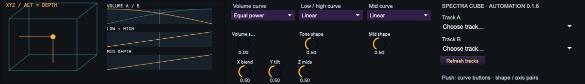
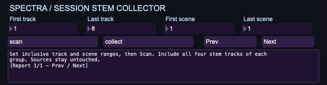

# Spectra · Max for Live

**Mix with a gesture. Make room for the next idea.**

Two small, editable tools for Ableton Live: **Spectra Cube Automation** turns a pair of tracks into an XYZ performance mixer; **Session Stem Collector** gathers separated clips into four shared Session tracks for remixing and improvisation.

[Device page](https://spectrascope.net/max-for-live/) · [Downloads](https://github.com/mnicholas7/max-for-live-devices/releases) · [Issues & ideas](https://github.com/mnicholas7/max-for-live-devices/issues)

| Device | Useful when… | Current release |
| --- | --- | --- |
| [Spectra Cube Automation](devices/spectra-cube-automation/README.md) | You want to blend two parts, trade their spectral space and record the movement with Live’s automation. | [0.1.6](https://github.com/mnicholas7/max-for-live-devices/releases/tag/cube-automation-v0.1.6) · experimental |
| [Session Stem Collector](devices/stem-collector/README.md) | You have many four-stem groups and want one organized Drums / Bass / Vocals / Other clip palette. | [0.1.0](https://github.com/mnicholas7/max-for-live-devices/releases/tag/stem-collector-v0.1.0) · experimental |

## Spectra Cube Automation



Move **X** to blend track volumes, **Y** to trade lows and highs, and **Z** to balance the mids. Each axis has its own response curve and shape control. Start with Equal power volume and Linear EQ, or draw a custom curve. Push 3 puts shapes, axes and curve buttons on one front bank.

The performance lives in **Live’s XYZ automation lanes**. Record a transition once, edit its envelopes in Live and play it back with your Set. The current device uses event-driven parameter control and limits its display redraws to 20 fps; it does not run an internal recorder or poll targets during playback.

Both volume endpoints are 0 dB. One EQ Three directly on each target enables Y/Z; without an EQ Three, volume mixing still works. [Setup, curves and Push guide →](devices/spectra-cube-automation/README.md)

## Session Stem Collector



Live’s separated stems can leave you with a group for every source clip. The collector brings their clips together into four fresh tracks: **Collected Drums, Collected Bass, Collected Vocals and Collected Other**. Browse drum loops against another source’s bass, swap vocals or build a new performance from a common palette.

Choose a track/scene rectangle, **Scan** its matching groups, inspect the preview, then **Collect**. Copies stay aligned by source row and the new tracks start muted. Original clips remain in place. The collector organizes clips; Live performs the stem separation first. [Workflow and limits →](devices/stem-collector/README.md)

## Download & install

Download the ZIP for the device you want and extract the whole folder. Keep its `.amxd` beside the supplied JavaScript files. These releases are portable folders, **not frozen single-file devices**. Load the ordinary `.amxd` on a spare MIDI track; the `Local` files produced by development builds are for the build machine only.

Requires Ableton Live with Max for Live. Development and user testing have used Live 12 Suite / Max 9. Native stem separation is needed only to prepare the collector’s input. Hardware display behavior and broader host compatibility remain under test; read each device’s verification notes before relying on it in a performance.

## Build & test

Node.js is required; there are no npm dependencies. Release packaging also uses Python 3’s standard library.

```sh
git clone https://github.com/mnicholas7/max-for-live-devices.git
cd max-for-live-devices
npm run build:automation
npm run build:stems
npm test
python3 scripts/package-releases.py
```

Sources, editable `.maxpat` patches, generated devices and tests are in this repository. The [older Cube documentation](docs/legacy-cube.md) and historic release tags remain available; the old internal-loop device and the current automation device have different parameter sets. Recorded envelopes are not automatically migrated between them.

## License

Both devices and their source are released under **GNU GPL version 3 only (`GPL-3.0-only`)**. See [LICENSE](LICENSE). You can use, study, modify and redistribute them under that license. Ableton Live and Max are separate products and are not included. This is an independent project, unaffiliated with Ableton or Cycling ’74.
