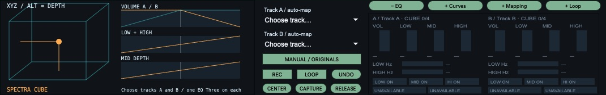
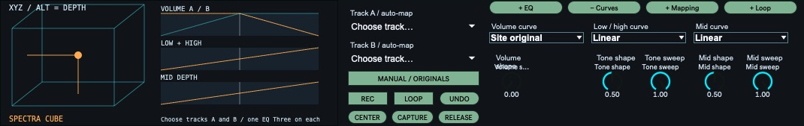
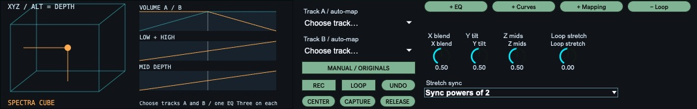
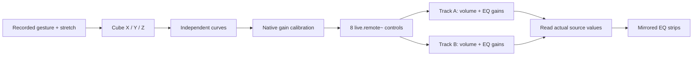

# Archived Cube documentation and development notes

These notes describe the older Cube and its repair experiments. For current downloads and setup, see the [repository README](../README.md).

# Spectra Max for Live devices

## Spectra Cube Automation — simple Live recording

The current simplified variant is in `devices/spectra-cube-automation/`. It has the Cube, X/Y/Z, Track A/B and Refresh tracks. Live records and plays **X blend / Y tilt / Z mids** on the Cube's track; those envelopes drive the connected gains. Push encoders 1–3 use the saved Cube bank. There are no internal recording, loop, release or write-mode controls. Mapping preserves captured track levels instead of resetting them to unity. See [setup](../devices/spectra-cube-automation/README.md). Build with `npm run build:automation`. The older full-featured Cube and its files remain preserved.

## Session Stem Collector (experimental)

Copy separated Session stems into four shared, newly created muted tracks. Scan previews matching four-stem groups; Collect keeps original clips untouched and refuses occupied destinations. See [setup and limitations](../devices/stem-collector/README.md). Build locally with `node scripts/build-stem-collector.cjs`; run its safety tests with `node tests/stem-collector.cjs`. This is an unfrozen local test, not a published release.

## 0.1.10 repair build

### Push 3 encoder test

The device now saves a first parameter bank named **Cube**: encoders 1–3 control **X blend**, **Y tilt**, and **Z mids**; slots 4–8 are empty. Load the rebuilt `Spectra Cube 0.1.10 Local.amxd` on the build machine, select its track and the Cube in Push's Device mode, and turn the first three encoders. No MIDI Map mode is needed. The mapping follows the selected device. The local build requires this checkout on the mounted OWC drive. Bank serialization and axis wiring are checked by the tests; physical Push operation still needs verification.

### Native automation experiment

At the user's request, the MIDI experiment was removed and **WRITE TEST** restored. Direct control is now event-driven, coalesced at 10 Hz, and caches the last sent values so unchanged targets cause neither API reads nor writes. WRITE TEST skips periodic EQ readbacks and idle transport polling when its internal loop is not running or recording. Drag persistence notifications are deferred until pointer release. Mapping/Reset Unity still use the API during setup: do those before recording. Live performance remains unverified; this is a mitigation, not a confirmed diagnosis of the reported slowdown.

No IAC bus or manual MIDI mappings are needed. Disable Remote on the dedicated Cube IAC input and remove any experimental Cube MIDI mappings before testing. Use the normal Choose Track A/B mapping, then enable WRITE TEST to release remote ownership. Leave internal LOOP off, enable Live Automation Arm and record a short Arrangement pass in a copied Set. Writes preserve the existing cube math but are control-rate without remote smoothing and may still affect Live's undo history. The write mode is deliberately not persisted.

After recording, turn **MANUAL on first**, then disable WRITE TEST. MANUAL stops internal loop playback, pending writes, the repeating scheduler and the selection observer. Re-enable Live automation and use Back to Arrangement if necessary. This lets native envelopes play without active Cube polling or target ownership. Manual edits to the separate EQ mirror controls remain possible. Returning from MANUAL resumes the normal scheduler and captures current gains as baselines. If playback still slows, remove the device from a copied Set to isolate it without deleting recorded envelopes.

The source tree now includes a repair for script-resolution and initialization failures reported with 0.1.9. It disables runtime script autowatching, bundles included helpers into three uniquely named scripts, uses numeric state blobs (with legacy JSON restore support), gates remote target messages until Live is ready, and retries connections after a scheduler gap or lost API connection. Saved bindings are retained when temporarily unavailable; reconnecting does not invoke Reset Unity.

`Spectra Cube 0.1.10 Local.amxd` uses absolute paths to this checkout's generated scripts for immediate testing on the build machine. Keep the checkout on the mounted drive. It is **not portable or frozen**. The ordinary `Spectra Cube 0.1.10.amxd` must remain beside its three `spectra-cube-*-0.1.10.js` files until frozen. `npm run build` also generates the named Max project in `release/Spectra Cube/` with explicit code dependencies for native freezing/export. Historical 0.1.1–0.1.9 files are no longer rewritten by builds.

Back up the Live Set before replacing a broken instance. Never overwrite an old device after Max has reported deleting patchcords. Unit tests exercise persistence, wake/reconnect scheduling and wiring; actual sleep/wake behavior in Live still needs validation. Native frozen export remains pending; the installed Max instance currently disables project export outside a Live device editor.

**Make the mix a gesture.** Open-source controllers for Ableton Live, starting with **Spectra Cube 0.1.9**: a three-dimensional mixer for two tracks’ volume and EQ Three gains.

[Download v0.1.9](https://github.com/mnicholas7/max-for-live-devices/releases/tag/v0.1.9) · [Project page](https://spectrascope.net/max-for-live/) · [Issues & ideas](https://github.com/mnicholas7/max-for-live-devices/issues)



*Real Max presentation screenshot, before mapping. Dimmed EQ strips are unavailable until tracks are selected. Target environment: Live 12.4.6 Suite / Max 9.1.5.*

## One point. Two tracks. Three dimensions.

| Axis | What moves |
| --- | --- |
| **X** | Track A / B volumes |
| **Y** | Opposing low/high EQ tilt on A / B |
| **Z** | Opposing mid EQ gains — depth handle or **Alt/Option-drag** |

At center, the default Site curve keeps both volumes at unity and EQ neutral. Move toward either track to blend the volumes; tilt the cube to trade spectral space.

- **Full DJ sweep:** complete cut to each target’s maximum boost, following its native gain-control scale.
- **Automatic mapping:** choose two tracks with one EQ Three directly on each. Volume plus three gains map together.
- **Actual readbacks:** mirrored strips display original volume, gains, crossover frequencies, bands, slope and EQ power.
- **Independent gesture loops:** record movements, snap to the nearest beat and loop across clip/scene changes.
- **Collapsible panels:** EQ, Curves, Mapping and Loop share one compact detail area.
- **Local and transparent:** no telemetry, cloud service, network calls or audio processing.

## Install in five steps

1. **Download and extract the ZIP.** Keep the `.amxd` and all five JS files together: `core.js`, `controller.js`, `cube-ui.js`, `eq-ui.js`, `layout.js`. This development release is not frozen into a standalone file.
2. **Prepare two tracks.** Add one EQ Three directly to each. Turn down your monitoring level before mapping.
3. **Load the Cube.** Drag `Spectra Cube 0.1.9.amxd` onto a dedicated **MIDI track**. It is a MIDI-effect controller that operates other tracks’ parameters, not an audio effect. MIDI passes through unchanged.
4. **Choose Track A and Track B.** Each successful selection resets **all currently mapped** volumes and EQ gains to **0 dB unity**, enables the three EQ bands, centers the cube and pauses gesture playback. Power, crossovers and slope stay unchanged.
5. **Move the point.** Drag normally for X/Y; hold **Alt/Option** for Z. Double-click centers without replacing baselines. **Mapping → Reset Unity** restores the known neutral setup later.

> **Unity is not maximum boost.** Mapping can restore an attenuated or muted track to an audible level. Two tracks at unity plus boosted EQ can clip. Monitor conservatively.

## Shape the response



*Real Max preview: the graphs and curve controls, with no Live targets connected.*

| Volume curves | EQ curves |
| --- | --- |
| Site original, Linear, Equal power, Soft blend, Sharp cut, Custom | Linear, Ease in, Ease out, S curve, Custom |

Volume, low/high and mid curves are independent. Shape adjusts their response; **Tone/Mid sweep** (0–1) controls travel, with 1 reaching the full native range. Draw the five-point graphs to select Custom automatically. The custom volume graph edits A normally, or B with Shift.

## Record the movement



1. Enable **REC** and move the cube.
2. Disable REC: duration snaps to the nearest beat, minimum one beat. The whole gesture stretches to fit rather than being trimmed.
3. **LOOP** follows Live’s transport. Recording while stopped uses Live’s current tempo.
4. **UNDO** restores the previous gesture.

| Stretch | Result |
| --- | --- |
| −2 / −1 | Quarter / half the original length |
| **0** | **Original length, 1:1** |
| +1 / +2 | Double / quadruple |

Free stretch is continuous; Sync rounds to powers of two. Stretch changes preserve phase. Loop length does not reset at clip, scene or arrangement-loop boundaries. Stop recording before selecting tracks or resetting unity.

## Mapping and original controls

**Manual mapping:** click a Map button **first**, then click the target volume fader or EQ **gain** knob in Live. Do not enable Live’s MIDI Map mode. Click the same Map button to cancel. Continuous dB parameters only; duplicate targets and the Cube’s own controls are rejected. Manual mapping captures existing baselines; Reset Unity afterward for a neutral start.

**Automatic mapping:** A and B must be different tracks. Missing or multiple EQ Threes are rejected. Rack-contained EQs require manual mapping; Refresh Tracks updates the list after track changes.

**MANUAL / ORIGINALS:** releases remote ownership without forgetting targets. Original gain controls and their automation become editable again. Switching it off captures current underlying gains as new baselines and reapplies the cube position; center first for an unchanged level with the default Site curve.

**RELEASE:** forgets targets and returns control to Live. Do not run multiple mapped cubes against the same parameters.

EQ-strip edits to cube-owned gains adjust their baselines. Move away from a fully muted volume or full-sweep EQ endpoint before trimming it. Crossovers, band enables, slope and power edit the originals directly; cube movement affects only volume and gains.

## Under the hood



Native values are not linear audio amplitudes. The controller samples each target’s formatted dB scale at 65 points. Volume attenuates relative to its captured baseline; DJ EQ sweeps interpolate native gain positions from that baseline to the endpoints. Calibration is approximate because formatted strings are rounded. Source readbacks are polled approximately ten times per second and never write themselves back.

## Build and test

Node.js is required for development; there are no npm dependencies.

```sh
git clone https://github.com/mnicholas7/max-for-live-devices.git
cd max-for-live-devices
npm run build
npm test
```

The generator writes an editable `.maxpat`, MIDI `.amxd` containers and `layout.js`. Older numbered filenames are **current-patch compatibility aliases**, not historical builds. Use release tags for historical sources. Reload the device after building to update whole-patch wiring; save your settings first.

## Verification and limitations

The user reports successful two-track control with 0.1.9. Automated mocked tests cover mixer math, all six EQ endpoints, unity mapping, baseline edits, mapping guards, readbacks, gestures, state and patch wiring. They do **not** prove complete host integration or audio performance.

- **Acceptance testing remains:** saved-Set reopening, original automation restoration and sustained control under load.
- `live.remote~` owns mapped parameters, disabling their original automation while connected. Use MANUAL or RELEASE to hand control back.
- Moved/deleted targets require remapping; stored bindings are checked by ID and path.
- Gesture playback resumes paused after loading; storage is capped at 36,000 samples.
- A 33 ms tempo-integrated scheduler is used, not sample-accurate transport position. Stalls can affect timing; mismatched endpoints can jump on wrap.
- The 1,070 logical-pixel device may require horizontal scrolling on small screens or at high Live UI zoom.
- Saved pre-0.1.9 states retain their legacy EQ response until Reset Unity or a track selection enables the full sweep.
- Browser/Ableton Link synchronization is **not** part of this device.

Before performance use, check all eight targets, confirm center/cut/boost directions, test record/stretch/undo, save/reopen a disposable Set, and verify Release restores original automation. Inspect Max’s console for ownership conflicts.

## Where it could go next

Frozen standalone releases · nested Rack discovery · larger/pop-out views · smoother loop seams · more curve handles · transport-accurate timing · additional linked cubes. These are proposals, not shipped features.

## License

**GNU GPL version 3 only** (`GPL-3.0-only`); see [LICENSE](../LICENSE). Use, study, modify and redistribute under that license. Ableton Live and Max are separate proprietary products and are not included. Independent project, not affiliated with Ableton or Cycling ’74.

References: [remote parameter control](https://docs.cycling74.com/reference/live.remote~), [Live parameter API](https://docs.cycling74.com/apiref/lom/deviceparameter/).
